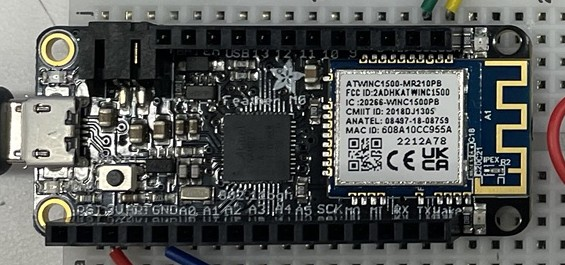
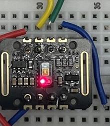
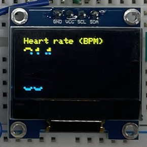
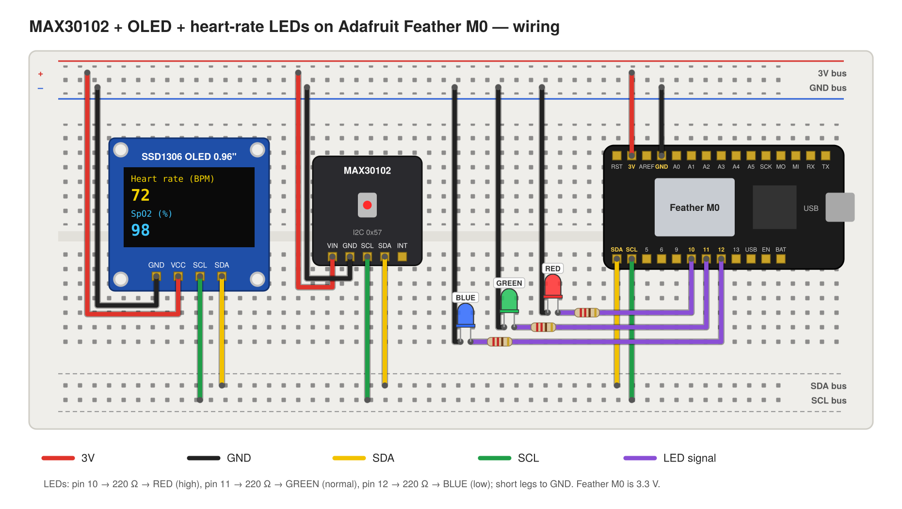

# MAX30102 Heart Rate & SpO2 with OLED Display and Heart Rate LEDs

An Arduino sketch that reads heart rate and blood oxygen (SpO2) from a MAX30102 pulse oximetry sensor, shows the results on a 0.96" SSD1306 OLED display, and lights a colored LED to show the heart rate zone at a glance:

| LED | Heart rate zone | Default range |
|---|---|---|
| 🔵 Blue | Low | below 60 BPM |
| 🟢 Green | Normal | 60–100 BPM |
| 🔴 Red | High | above 100 BPM |

The zone (LOW / NORMAL / HIGH) also appears on the OLED next to the heart rate. All LEDs stay off until there's a valid reading. Readings are also printed to the Serial Monitor / Serial Plotter.

This sketch is a modified version of SparkFun's **Example 8 – SPO2** from the [SparkFun MAX3010x library](https://github.com/sparkfun/MAX30105_Breakout). The original prints results only to the Serial Monitor; this version adds the OLED display and the heart rate LEDs. It builds on the same setup as the OLED-only version of this project, with three LEDs and resistors added.

<!-- Add a photo of the finished LED build here, e.g.:
 -->

## Parts list

| Photo | Part | Notes | Where to buy |
|---|---|---|---|
|  | Adafruit Feather M0 WiFi (ATWINC1500) | Used in this build. Any Feather M0 board works; the WiFi isn't used. | [Adafruit (product 3010)](https://www.adafruit.com/product/3010) |
|  | MAX30102 pulse oximeter / heart rate sensor module | I2C, address 0x57 | [Amazon – Diitao MAX30102](https://www.amazon.com/dp/B0BBDWLP86) |
|  | ELEGOO 0.96" OLED display, SSD1306, 128×64, I2C (4-pin) | Address 0x3C. Works at 3.3 V. | [Amazon – ELEGOO 0.96" OLED](https://www.amazon.com/dp/B0D2RMQQHR) |
| | 5 mm LEDs: 1 red, 1 green, 1 blue | Any standard 5 mm (or 3 mm) LEDs | — |
| | 3 × 220 Ω resistors | One per LED, to limit current (see note on blue LEDs below) | — |
| | Breadboard (full size) and jumper wires | Any standard breadboard | — |
| | Micro-USB cable | Data cable (not charge-only) for uploading the sketch | — |
| | Rubber band or tape | Holds your finger on the sensor; steady pressure gives much better readings | — |

Part photos are cropped from the build photo of the OLED-only version. Links are for reference; equivalent parts from other sellers work the same way. Some boards come with the header pins unsoldered, so you may need to solder them before using a breadboard.

## Wiring

The sensor and OLED share the I2C bus, so they connect to the same SDA and SCL pins on the Feather. Each LED connects to its own digital pin through a resistor.



The outer breadboard rails are used as shared buses: one pair for 3V and GND, the other pair for SDA and SCL. Wire colors in the diagram: red = 3V, black = GND, yellow = SDA, green = SCL, purple = LED signal.

**Sensor and display**

| Module pin | Feather M0 pin |
|---|---|
| MAX30102 VIN | 3V |
| MAX30102 GND | GND |
| MAX30102 SDA | SDA |
| MAX30102 SCL | SCL |
| MAX30102 INT | not connected |
| OLED VCC | 3V |
| OLED GND | GND |
| OLED SDA | SDA |
| OLED SCL | SCL |

**LEDs**

| Feather M0 pin | Connects to | LED leg | Other LED leg |
|---|---|---|---|
| 10 | 220 Ω resistor → | Red LED, long leg (+) | short leg (−) → GND |
| 11 | 220 Ω resistor → | Green LED, long leg (+) | short leg (−) → GND |
| 12 | 220 Ω resistor → | Blue LED, long leg (+) | short leg (−) → GND |

**Notes:**
- **LED direction matters.** The long leg (anode, +) goes toward the Feather pin; the short leg (cathode, −), usually next to the flat edge of the LED, goes to GND. A backwards LED simply won't light.
- **Blue LEDs at 3.3 V:** blue LEDs need about 3 V to turn on, so on a 3.3 V board they can look dim with 220 Ω. If yours is too dim, use a 100 Ω resistor for the blue LED.
- The Feather M0 is a 3.3 V board, and its pins aren't 5 V tolerant. Power the sensor and OLED from the **3V** pin.
- On the Feather M0, A4 and A5 are **not** I2C pins (unlike the Arduino Uno). Use the pins labeled SDA and SCL.
- On the Feather M0 **WiFi**, pins 2, 4, 7 and 8 are used by the WiFi module, so don't use them for the LEDs. Pin 13 is the onboard LED, which the sketch blinks with each sensor reading.
- I2C addresses: MAX30102 = `0x57`, OLED = `0x3C` (some modules use `0x3D`; change `OLED_ADDRESS` in the sketch if needed).

## Libraries

Install these from the Arduino Library Manager:

- SparkFun MAX3010x Pulse and Proximity Sensor Library
- Adafruit SSD1306
- Adafruit GFX Library

## Usage

1. Wire the circuit as shown in the wiring diagram.
2. Install the libraries.
3. Upload `MAX30102_SpO2_OLED_LEDs.ino` to the Feather M0.
4. At startup, the red, green and blue LEDs flash once each. This is a quick check that all three are wired correctly.
5. Place your finger on the sensor and hold it steady.
6. After about 4 seconds (the first 100 samples), heart rate and SpO2 appear on the OLED and update about once per second. One LED lights to show the heart rate zone. The display shows `--` and all LEDs stay off when a reading isn't valid yet.
7. Optional: open the Serial Monitor or Serial Plotter at **115200 baud** to see the readings there too.

## Changing the heart rate zones

The zone limits are set near the top of the sketch:

```cpp
#define HR_LOW_MAX  60    // below this = LOW (blue)
#define HR_HIGH_MIN 100   // above this = HIGH (red)
```

The defaults match the typical resting range for adults (about 60–100 BPM). Resting heart rates for children are higher, and heart rate rises during exercise, so adjust these numbers to fit who's using it and what you want to show. You can also change which pin drives each LED with `RED_LED_PIN`, `GREEN_LED_PIN` and `BLUE_LED_PIN`.

## Changes from the SparkFun example

**Added**
- OLED output: heart rate and SpO2 are displayed on an SSD1306 OLED using the Adafruit SSD1306/GFX libraries.
- Heart rate LEDs: red, green and blue LEDs on pins 10, 11 and 12 show whether the heart rate is high, normal or low.
- `heartRateZone()` function: sorts the current heart rate into low / normal / high (or none, if invalid) using `HR_LOW_MAX` and `HR_HIGH_MIN`.
- `updateLEDs()` function: lights the LED for the current zone and turns the others off.
- `testLEDs()` function: flashes each LED once at startup to check the wiring.
- `updateDisplay()` function: shows HR, the zone (LOW / NORMAL / HIGH) and SpO2 on the OLED, or `--` when a reading is invalid. Called after each HR/SpO2 calculation, along with `updateLEDs()`.
- `showMessage()` function: shows status messages on the OLED (e.g. "Place finger on sensor...", "Sensor not found!").

**Removed**
- The "Press any key to start conversion" prompt and the wait for a keypress, so the sketch starts on its own.
- `pulseLED` (pin 11) and `MAX_BRIGHTNESS`, which were defined in the original but never used.
- Printing of raw `red=` and `ir=` values for every sample.

**Changed**
- Serial output: instead of 25 lines per second with raw values and validity flags, the sketch prints one line per calculation (about once per second) in the format `HR:72,SpO2:98`, which the Serial Plotter can read. Invalid readings print as `0`.
- The "sensor not found" error message now names the MAX30102 (instead of MAX30105) and also appears on the OLED.

**Unchanged**
- All sensor settings (LED brightness, sample averaging, sample rate, pulse width, ADC range).
- The 100-sample buffer, the shift-25-samples loop, and Maxim's `maxim_heart_rate_and_oxygen_saturation()` algorithm.

## Troubleshooting

- **An LED never lights:** check that it isn't in backwards (long leg toward the resistor and Feather pin) and that its short leg reaches GND. Watch the startup flash: each LED should blink once, red → green → blue.
- **Wrong LED for the zone:** check that each LED is on the pin listed in the wiring table, or change the `..._LED_PIN` numbers in the sketch to match your wiring.
- **No serial output:** the Feather M0 has native USB, so text printed before the Serial Monitor connects can be lost. Check that the monitor is set to 115200 baud and the correct port is selected.
- **OLED not found:** check that the OLED's header pins are soldered and that VCC/GND aren't swapped. Run an I2C scanner sketch to see which addresses respond.
- **OLED not found only when the MAX30102 is connected:** some MAX30102 modules (often the small purple boards) pull the I2C lines up to 1.8 V, which is too low for the SSD1306. Look for a 1.8V/3.3V solder jumper on the sensor board and set it to 3.3 V.
- **Invalid or jumpy readings:** hold your finger with steady, light pressure (a rubber band helps). Pressing too hard or moving changes blood flow and throws off the readings, and can make the LEDs jump between zones.

## Credits

- Original example by Nathan Seidle, SparkFun Electronics (October 2016): [SparkFun MAX30105 Breakout](https://github.com/sparkfun/MAX30105_Breakout)
- Based on Maxim Integrated's MAXREFDES117 reference design and RD117_LILYPAD.ino
- SpO2 and heart rate algorithm (`spo2_algorithm`) by Maxim Integrated
- OLED display libraries by Adafruit

Please see the SparkFun library's license file for license details on the original code.

## AI assistance

This code and documentation were generated with the assistance of AI (Claude, by Anthropic) and may contain errors. Test the circuit and code yourself, and double-check the wiring before powering it on. Corrections and suggestions are welcome.

## Disclaimer

This is a hobby/educational project, not a medical device. The LED zones are simple cutoffs for demonstration, not a health assessment. Don't use its readings for medical decisions.
